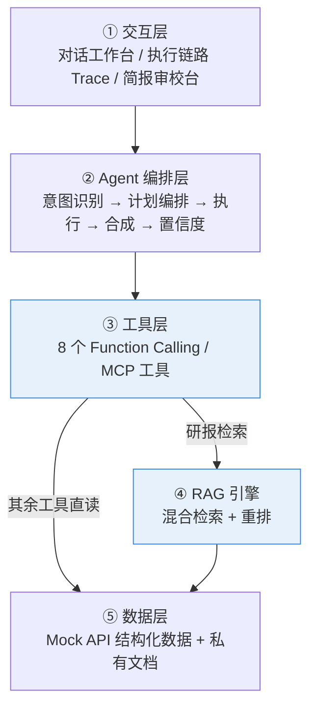
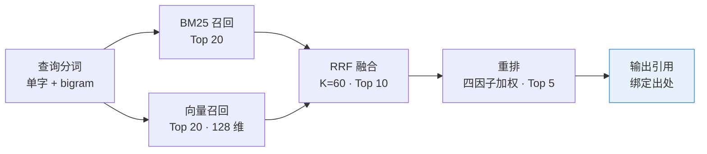
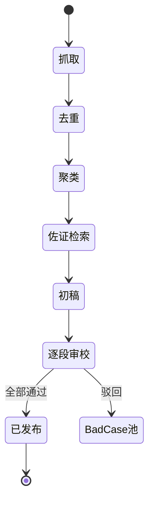

# AI 投研分析智能体（二级市场版）

> 面向二级市场投资经理与行业研究员，覆盖 **数据检索 → 研报分析 → 知识管理 → 自动化简报** 全流程的 AI Agent。
> 纯前端实现的 Web Demo，零依赖、零构建，双击 `index.html` 即可运行。

---

## 一、项目背景

二级市场投研工作存在四个高频痛点：

| 痛点 | 具体表现 |
| --- | --- |
| 数据检索繁琐 | 行情、财务、新闻、公告分散在多个终端，需要反复切换、手工拼表 |
| 研报分析耗时 | 一份深度研报数十页，定位关键观点与数据需要通读 |
| 知识管理分散 | 历史纪要、年报风险章节沉淀在本地文件夹，无法按问题检索 |
| 简报撰写重复 | 每日盘前简报高度模板化，但整理、去重、排版消耗大量时间 |

本项目把投研需求抽象为 **找数据、读研报、记知识、写简报** 四个核心场景，用 Agent 的方式逐个落地。

> **数据说明**：Demo 中的 4 家上市公司、财务数据、新闻与研报均为**虚构构造**，仅用于演示产品逻辑，不构成任何投资参考。

---

## 二、快速开始

```bash
# 方式一：直接打开（推荐）
open index.html

# 方式二：本地服务
python3 -m http.server 8899
# 浏览器访问 http://localhost:8899
```

无需 npm install，无需构建，无网络请求。

---

## 三、整体架构



**分层的核心目的**：工具以「JSON Schema 声明 + 执行函数」注册，编排层只依赖声明、不依赖实现。把 Mock 数据换成真实 HTTP 接口或 MCP Server，编排层代码无需改动。

---

## 四、六个功能模块

| 模块 | 对应场景 | 关键内容 |
| --- | --- | --- |
| 对话工作台 | 找数据 + 读研报 | 提问后右侧实时渲染 Agent Trace 四段式链路：意图 → 计划 → 执行 → 评分 |
| 工具与调用链路 | — | 8 个工具的参数 Schema、调用耗时、返回体大小，全量日志可回放 |
| RAG 知识库 | 记知识 | 索引统计 + 检索调试台，可查看每一步分数与片段位次变化 |
| 每日监控工作流 | 写简报 | 5 阶段流水线，各阶段耗时实时刷新 |
| 简报审校与发布 | 写简报 | Human-in-the-loop：逐段采纳 / 修改 / 驳回，未审校禁止发布 |
| 设计与边界 | — | 四场景卡片、人机职责边界、降级策略说明 |

---

## 五、技术实现要点

### 5.1 工具层：8 个 Function Calling 工具

工商画像、财务抓取、行情估值、新闻检索、**研报检索（RAG）**、产业链图谱、估值测算、同业对比。

每个工具统一由 `invoke()` 调度，内置随机网络延迟（180–520ms）、可注入故障率、全量调用日志。

### 5.2 RAG：五段式混合检索链路



- **分块**：句级滑窗，块长 120–260 字，保留上一块末句做 overlap，避免跨块语义断裂
- **向量化**：中文 bigram hashing → 128 维，亚线性 tf 平滑 + L2 归一（真实环境替换为 embedding API，链路结构不变）
- **为什么双路召回**：投研文本专有名词密集。纯向量会把「加工费」与「加工」混淆；纯 BM25 抓不住「怎么看」这类语义提问
- **为什么 RRF**：只看名次不看分数，规避两条路径分数不可比的问题
- **重排权重**：覆盖度 0.40 + 来源权威性 0.25 + 时效性 0.20 + 命中密度 0.15

> 每一步的中间分数与 rank 位移全部对外暴露，可直接查看某个片段「融合第 3 → 重排第 1」的变化过程。

### 5.3 编排：Plan-then-Execute

未采用纯 ReAct 自主循环，而是**先产出可见计划，再顺序执行**。

| 对比项 | 纯 ReAct 循环 | Plan-then-Execute（本项目） |
| --- | --- | --- |
| 工具选择 | 模型自主决定，不可预知 | 先出计划，用户可见可干预 |
| 轮次成本 | 不可控 | 固定，取决于计划步数 |
| 过程可解释性 | 黑盒 | Trace 面板完整回放 |
| 出错复现 | 困难 | 计划 + 日志可完整复现 |

意图识别采用 **8 类意图规则表**打分（估值 / 产业链 / 动态 / 对比 / 简报 / 研报 / 基本面 / 画像），输出主意图与次意图。编排完成后会按工具的 `required` 参数做一次**过滤**，必填参数取不到的步骤直接丢弃，避免带着空参数调用工具。

### 5.4 置信度：可拆解的五因子加权

| 因子 | 权重 | 计算方式 | 得分低意味着 |
| --- | --- | --- | --- |
| 检索质量 | 0.30 | 重排 top1 × 1.35 | 知识库中缺乏真正相关的材料 |
| 引用覆盖度 | 0.20 | 命中片段数 / 4 | 依据过于单薄 |
| 工具成功率 | 0.20 | 成功工具数 / 总调用数 | 有数据源调用失败 |
| 数据时效性 | 0.15 | 最新数据距今分档 | 使用了陈旧材料 |
| 结构化支撑 | 0.15 | 结构化数据源数 / 2 | 仅有文本，缺少硬数据 |

分档：**≥ 0.75 高**（可直接引用）｜**0.55–0.75 中**（建议复核关键数字）｜**< 0.55 低**（明确提示「需人工判断，勿直接对外」）

关键不在于分数本身，而在于**能定位是哪一项拖低了可信度**，从而反向指导运营动作。

### 5.5 定时任务与 Human-in-the-loop



- **去重双策略**：URL 归一化（去除 query 参数与尾斜杠）+ 标题 bigram Jaccard 相似度 ≥ 0.6
- **发布硬拦截**：`publish()` 前置校验，存在未审校段落或被驳回段落时直接返回 `ok: false`
- **全程留痕**：编辑 diff、审校人、发布时间、版本号
- **Bad Case 池**：驳回段落连同理由入池，用于后续复盘迭代

对话中识别到「生成简报」意图时，**不直接输出结论**，而是转交定时任务工作流并自动跳转审校页。AI 产出永远停在「初稿」状态。

---

## 六、关键产品取舍

| 取舍 | 选择 | 理由 |
| --- | --- | --- |
| 编排方式 | Plan-then-Execute | 投研要求可解释、可干预、可复现；纯自主循环无法满足 |
| 检索策略 | BM25 + 向量混合 | 单一路径无法兼顾专有名词精确匹配与语义泛化 |
| 置信度呈现 | 拆解为五个因子 | 单一分数无法指导「下一步该补什么」 |
| 交付边界 | AI 只到初稿，人工闭环 | 投研结论对外承担责任，必须有明确的责任人节点 |
| 技术栈 | 纯前端静态 | Demo 阶段精力集中在 Agent 逻辑本身，不耗在鉴权与环境上 |

---

## 七、已知不足

1. **知识库规模偏小**：当前仅 6 篇文档、18 个切片，未达到能验证检索效果的量级
2. **意图识别为规则驱动**：关键词规则表维护成本随场景增多而上升，真实场景应替换为小模型分类 + 规则兜底
3. **数据源为 Mock**：尚未接入真实行情 / 财务 / 新闻 API，也未实现 MCP Server 对接
4. **无长期记忆**：多轮对话之间不共享上下文，未实现用户偏好与历史决议的持久化

---

## 八、文件结构

```
invest-research-agent/
├── index.html      界面结构（六个 Tab）
├── style.css       浅灰底 + 白卡片 + #3567d6 主色视觉体系
├── data.js         种子数据：4 标的 / 16 新闻 / 6 篇私有原文 / 4 条产业链
├── tools.js        Function Calling 工具注册表 + 调用运行时
├── rag.js          RAG 引擎：分块 / 向量化 / 混合检索 / 重排
├── agent.js        编排层：意图识别 / 计划 / 执行 / 合成 / 置信度
├── workflow.js     定时任务流水线 + HITL 审校发布
└── app.js          界面渲染与交互逻辑
```

数据遵循 A 股习惯：**涨红跌绿**，货币单位为 **¥**。
